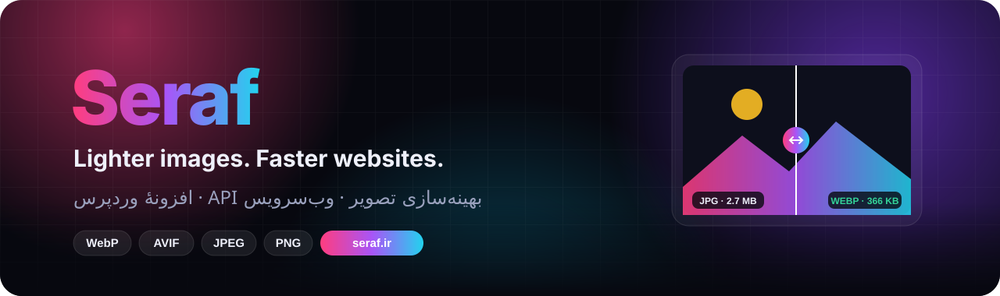
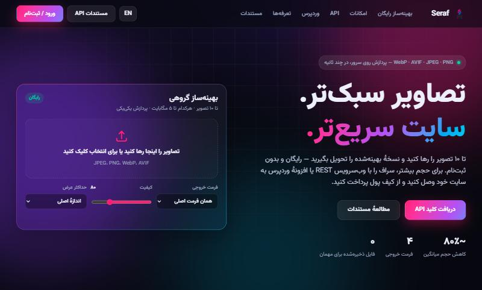
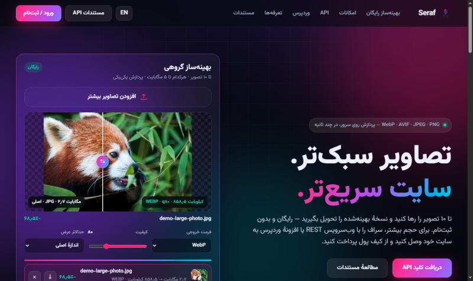
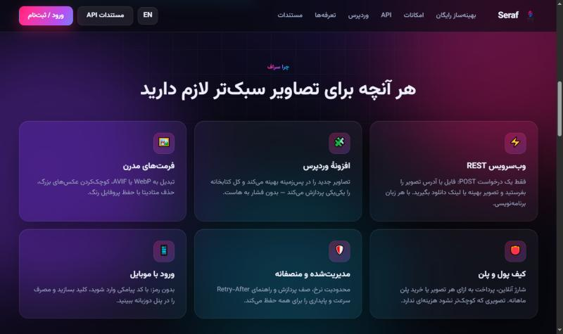
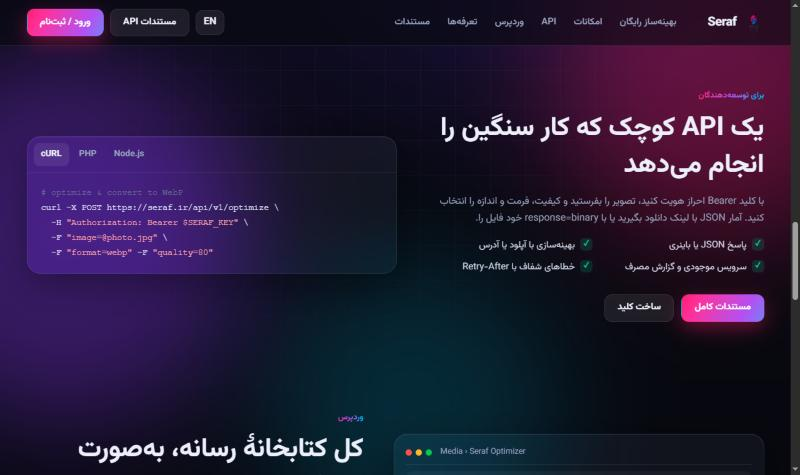
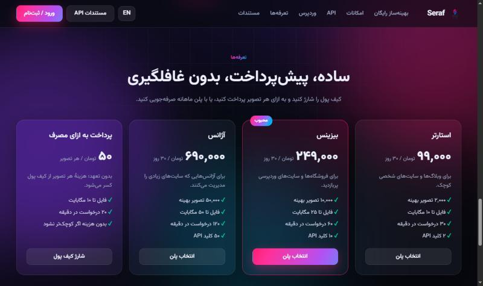
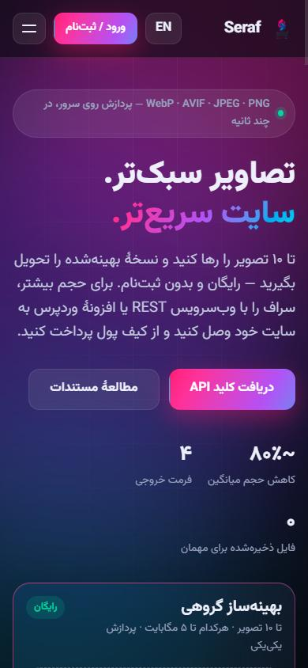
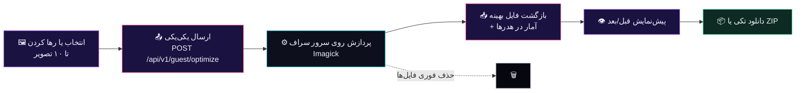
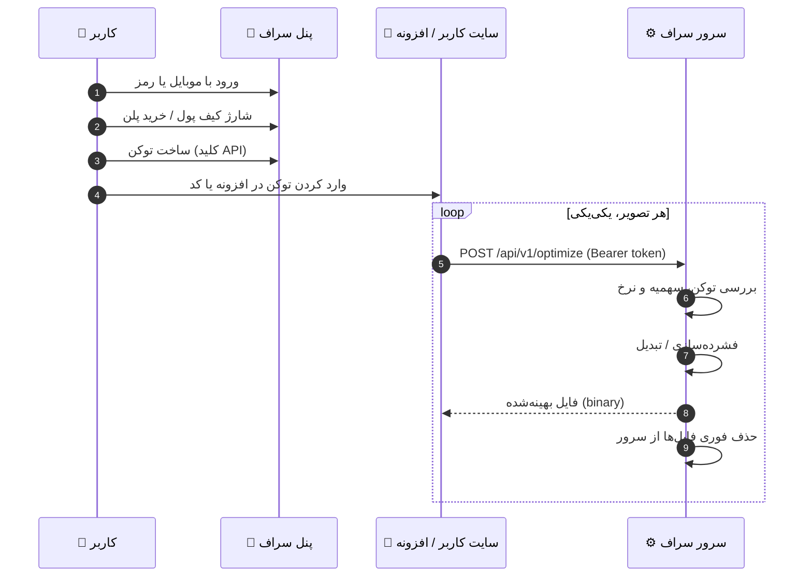
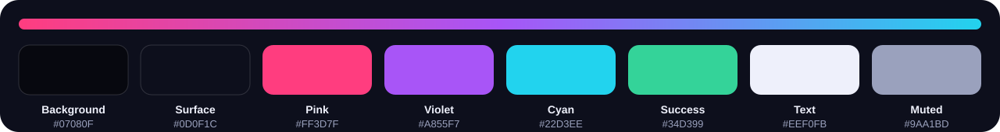

<p align="center">
  
</p>

<p align="center">
  <a href="https://seraf.ir"></a>
  <a href="docs/api.html"></a>
  
  
</p>

<div dir="rtl">

<h1 align="center">سراف · فرانت‌اند</h1>

<p align="center">
  <b>بهینه‌ساز رایگان تصویر</b>، <b>وب‌سرویس REST</b> و <b>افزونهٔ وردپرس</b> برای سبک‌تر کردن تصاویر وب<br>
  این مخزن فقط شامل <b>بخش فرانت‌اند</b> سایت <a href="https://seraf.ir">seraf.ir</a> است.
</p>

<p align="center">
  <a href="#-معرفی">معرفی</a> •
  <a href="#-امکانات">امکانات</a> •
  <a href="#-پیشنمایش">پیش‌نمایش</a> •
  <a href="#-نحوهٔ-کار">نحوهٔ کار</a> •
  <a href="#-ساختار-پروژه">ساختار</a> •
  <a href="#-وبسرویس-api">API</a> •
  <a href="#-افزونهٔ-وردپرس">وردپرس</a> •
  <a href="#-پالت-رنگی">پالت رنگی</a> •
  <a href="#-اجرای-محلی">اجرا</a>
</p>

---

## ✨ معرفی

**سراف** سرویسی برای بهینه‌سازی تصاویر است. حجم عکس‌ها را بدون افت محسوس کیفیت کم می‌کند، ابعادشان را مناسب وب می‌کند و آن‌ها را به فرمت‌های مدرن **WebP** و **AVIF** تبدیل می‌کند. همهٔ پردازش‌ها روی سرورهای سراف انجام می‌شود.

سه راه برای استفاده وجود دارد:

| راه | برای چه کسی | هزینه |
|:--|:--|:--|
| 🖼️ **بهینه‌ساز آنلاین صفحهٔ اصلی** | همه، بدون ثبت‌نام — تا ۱۰ تصویر در هر نوبت | رایگان |
| ⚡ **وب‌سرویس REST** | برنامه‌نویس‌ها؛ اتصال به هر سایت و هر زبان برنامه‌نویسی | از کیف پول یا پلن |
| 🧩 **افزونهٔ وردپرس** | صاحبان سایت‌های وردپرسی؛ بهینه‌سازی خودکار کل کتابخانهٔ رسانه | از کیف پول یا پلن |

کاربر با **شماره موبایل** (کد پیامکی) یا **نام کاربری و رمز** ثبت‌نام می‌کند، کیف پولش را با درگاه بانکی شارژ می‌کند یا پلن ماهانه می‌خرد، یک **توکن (کلید API)** می‌سازد و با همان توکن از وب‌سرویس یا افزونه استفاده می‌کند.

---

## 🚀 امکانات

<table>
<tr>
<td width="50%" valign="top">

### 🖼️ بهینه‌ساز گروهی رایگان
- کشیدن و رها کردن، انتخاب فایل یا Paste — تا **۱۰ تصویر**
- شروع **خودکار** پردازش، **یکی‌یکی و پشت سر هم** روی سرور
- **پیش‌نمایش قبل/بعد** با خط کشویی، به‌همراه حجم، فرمت و کیفیت
- تغییر فرمت، کیفیت یا عرض و **بهینه‌سازی دوبارهٔ فوری**
- دانلود تکی یا **یکجا به‌صورت ZIP** (ساخته‌شده در مرورگر)
- بدون ذخیرهٔ هیچ فایلی روی سرور

</td>
<td width="50%" valign="top">

### 🎨 رابط کاربری
- طراحی تیره و مدرن با گرادیان‌های متحرک و کارت‌های شیشه‌ای
- **دوزبانه:** انگلیسی و فارسی با پشتیبانی کامل راست‌به‌چپ
- فونت **وزیرمتن** و اعداد فارسی
- واکنش‌گرا برای موبایل و تبلت
- بدون فریم‌ورک و وابستگی — HTML، CSS و JavaScript خالص
- تعرفه‌ها به‌صورت زنده از API خوانده می‌شوند

</td>
</tr>
<tr>
<td valign="top">

### ⚡ وب‌سرویس
- فرمت‌های خروجی: `original` · `jpeg` · `png` · `webp` · `avif`
- ورودی با آپلود فایل یا آدرس اینترنتی (URL)
- پاسخ JSON با لینک یک‌بارمصرف، یا خود فایل (`binary`)
- محدودیت نرخ شفاف با `Retry-After`

</td>
<td valign="top">

### 👛 کیف پول و پلن‌ها
- شارژ آنلاین با درگاه بانکی
- پرداخت به ازای هر تصویر یا خرید پلن ماهانه
- اگر تصویر کوچک‌تر نشود، **هزینه‌ای کسر نمی‌شود**
- پنل کاربری و پنل مدیریت کامل، دوزبانه

</td>
</tr>
</table>

---

## 📸 پیش‌نمایش

<p align="center">
  
</p>

<table>
<tr>
<td width="50%"><p align="center"><sub>پیش‌نمایش قبل/بعد با حجم و کیفیت</sub></p></td>
<td width="50%"><p align="center"><sub>امکانات سرویس</sub></p></td>
</tr>
<tr>
<td><p align="center"><sub>معرفی API با نمونه‌کد</sub></p></td>
<td><p align="center"><sub>تعرفه‌های زنده</sub></p></td>
</tr>
</table>

<p align="center">
  <br>
  <sub>نمای موبایل</sub>
</p>

---

## 🔄 نحوهٔ کار

### بهینه‌ساز صفحهٔ اصلی



### وب‌سرویس و افزونهٔ وردپرس



> [!IMPORTANT]
> افزونهٔ وردپرس **هیچ موتور فشرده‌سازی‌ای ندارد**. هر تصویر با توکن کاربر به سرور سراف فرستاده و همان‌جا پردازش می‌شود، و نتیجه به سایت کاربر برمی‌گردد. بدون توکن معتبر و اعتبار کافی هیچ پردازشی انجام نمی‌شود.

---

## 🗂 ساختار پروژه

```
seraf.ir/
├── index.html              ← صفحهٔ اصلی (لندینگ + بهینه‌ساز گروهی)
├── static/
│   ├── home.css            ← استایل صفحهٔ اصلی (تم تیره، RTL، واکنش‌گرا)
│   └── home.js             ← ترجمه، تعرفه‌ها، صف پردازش، پیش‌نمایش، سازندهٔ ZIP
├── panel/assets/
│   ├── app.css             ← استایل پنل کاربری و مدیریت (روشن/تیره، RTL)
│   └── app.js              ← تعامل‌های پنل (کپی، تأیید، ورودی مبلغ، شمارش معکوس)
├── serviceworker.js        ← پاک‌کنندهٔ کش قدیمی تا همه صفحهٔ جدید را ببینند
├── .htaccess               ← تغییر مسیر /editor و هدرهای کش (LiteSpeed/Apache)
└── docs/
    ├── API.txt             ← مستندات کامل API (متنی)
    ├── api.html            ← مستندات کامل API (گرافیکی)
    └── screenshots/        ← تصاویر README
```

> [!NOTE]
> بک‌اند (PHP، پایگاه داده، کیف پول، درگاه پرداخت، پیامک و قالب‌های پنل) در این مخزن **نیست**. فایل‌های این مخزن روی هاست در ریشهٔ `public_html` قرار می‌گیرند و با مسیرهای `/api/v1/*` و `/panel/*` همان دامنه با بک‌اند ارتباط دارند.

### نگاهی به کد فرانت‌اند

| بخش | توضیح |
|:--|:--|
| **صف پردازش** | تصاویر به‌محض اضافه شدن در صف قرار می‌گیرند و یکی‌یکی ارسال می‌شوند. تصویری که در پیش‌نمایش است همیشه اولویت دارد. |
| **تلاش دوباره** | در پاسخ `503 server_busy` به اندازهٔ `Retry-After` صبر و دوباره ارسال می‌کند؛ قطعی شبکه هم تا سه بار تکرار می‌شود. |
| **تنظیمات زنده** | تغییر کیفیت، فرمت یا عرض (با تأخیر کوتاه برای کاهش درخواست‌ها) تصویر فعلی را فوراً دوباره بهینه می‌کند. |
| **سازندهٔ ZIP** | یک نویسندهٔ ZIP کم‌حجم با CRC32، بدون کتابخانهٔ خارجی؛ چون تصاویر از قبل فشرده‌اند، در حالت Store ذخیره می‌شوند. |
| **دوزبانه** | ویژگی `data-i18n` روی عناصر، دیکشنری فارسی و تغییر `dir`؛ زبان در کوکی `seraf_lang` ذخیره و با پنل هماهنگ می‌شود. |
| **حالت ورود** | با `GET /panel/me` بررسی می‌کند کاربر وارد شده یا نه و دکمهٔ «ورود» را به «پنل کاربری» تبدیل می‌کند. |

---

## ⚡ وب‌سرویس (API)

<table>
<tr><td>

**آدرس پایه:** `https://seraf.ir/api/v1` · **احراز هویت:** `Authorization: Bearer srf_…`

| متد | مسیر | دسترسی | کاربرد |
|:--:|:--|:--:|:--|
| `GET` | `/v1/status` | عمومی | وضعیت سرویس و فرمت‌ها |
| `GET` | `/v1/plans` | عمومی | پلن‌ها و قیمت‌ها |
| `GET` | `/v1/account` | توکن | موجودی، پلن و محدودیت‌ها |
| `GET` | `/v1/usage` | توکن | گزارش مصرف |
| `POST` | `/v1/optimize` | توکن | بهینه‌سازی تصویر |
| `GET` | `/v1/download/{token}` | لینک | دانلود یک‌بارمصرف |
| `POST` | `/v1/guest/optimize` | عمومی | بهینه‌ساز رایگان صفحهٔ اصلی |

</td></tr>
</table>

```bash
curl -X POST https://seraf.ir/api/v1/optimize \
  -H "Authorization: Bearer $SERAF_KEY" \
  -F "image=@photo.jpg" -F "format=webp" -F "quality=80"
```

```json
{
  "ok": true,
  "data": {
    "status": "ok",
    "input":  { "format": "jpeg", "bytes": 482113 },
    "output": { "format": "webp", "bytes": 98314, "width": 1600, "height": 1067 },
    "saved_percent": 79.61,
    "charged": 50,
    "download_url": "https://seraf.ir/api/v1/download/…"
  }
}
```

📘 **مستندات کامل:** [`docs/api.html`](docs/api.html) (گرافیکی) · [`docs/API.txt`](docs/API.txt) (متنی)<br>
شامل همهٔ پارامترها، کدهای خطا، محدودیت‌ها و نمونه‌کد cURL، PHP، Node.js و Python.

---

## 🧩 افزونهٔ وردپرس

1. در [پنل سراف](https://seraf.ir/panel/) وارد شوید و افزونه را از بخش «افزونه وردپرس» دانلود کنید.
2. در وردپرس از مسیر «افزونه‌ها ← افزودن ← بارگذاری افزونه» آن را نصب و فعال کنید.
3. در پنل سراف یک کلید API بسازید.
4. در وردپرس به «رسانه ← بهینه‌ساز سراف ← تنظیمات» بروید و کلید را وارد کنید.
5. تصاویر جدید خودکار بهینه می‌شوند؛ کتابخانهٔ فعلی را با «بهینه‌سازی گروهی» پردازش کنید.

| ویژگی | توضیح |
|:--|:--|
| ⏱ پردازش آرام | یکی‌یکی با مکث قابل تنظیم؛ هاست تحت فشار قرار نمی‌گیرد |
| 🔁 ادامه‌پذیر | تصاویر انجام‌شده هرگز دوباره هزینه ندارند |
| 💾 پشتیبان | نسخهٔ اصلی نگه داشته می‌شود و با یک کلیک برمی‌گردد |
| 🌐 WebP | ساخت نسخهٔ WebP و نمایش خودکار آن روی Apache و LiteSpeed |
| 👛 موجودی زنده | نمایش موجودی، سهمیه و میزان صرفه‌جویی در پیشخوان وردپرس |

---

## 🎨 پالت رنگی

<p align="center">
  
</p>

| نقش | رنگ | متغیر CSS |
|:--|:--|:--|
| پس‌زمینه |  `#07080F` | `--bg` |
| سطح |  `#0D0F1C` | `--bg-2` |
| صورتی (اصلی) |  `#FF3D7F` | `--pink` |
| بنفش |  `#A855F7` | گرادیان |
| فیروزه‌ای |  `#22D3EE` | `--cyan` |
| موفقیت |  `#34D399` | `--green` |
| متن |  `#EEF0FB` | `--text` |
| متن کم‌رنگ |  `#9AA1BD` | `--muted` |

گرادیان اصلی: `linear-gradient(120deg, #ff3d7f 0%, #a855f7 50%, #22d3ee 100%)`

---

## 💻 اجرای محلی

صفحهٔ اصلی کاملاً ایستا است و با هر وب‌سرور ساده‌ای اجرا می‌شود:

```bash
npx serve .
```

یا:

```bash
python -m http.server 8080
```

> [!TIP]
> بهینه‌ساز، تعرفه‌ها و وضعیت ورود از مسیرهای `/api/v1/*` و `/panel/*` **همان دامنه** استفاده می‌کنند. برای کارکرد کامل در محیط محلی، این دو مسیر را با یک پراکسی به `https://seraf.ir` هدایت کنید، یا فایل‌ها را روی هاستی بگذارید که بک‌اند سراف روی آن نصب است.

### استقرار روی هاست

| فایل مخزن | مسیر روی هاست |
|:--|:--|
| `index.html`، `serviceworker.js`، `.htaccess` | `public_html/` |
| `static/` | `public_html/static/` |
| `panel/assets/` | `public_html/panel/assets/` |

---

## 🔐 حریم خصوصی

- بهینه‌ساز رایگان و حالت `binary` هیچ فایلی روی سرور نگه نمی‌دارند.
- لینک‌های دانلود حالت JSON **یک‌بارمصرف** هستند و حداکثر ۱۰ دقیقه اعتبار دارند.
- برای گزارش مصرف فقط نام فایل، حجم، فرمت و زمان ثبت می‌شود.

---

<p align="center">
  <a href="https://seraf.ir"><b>seraf.ir</b></a> · <a href="https://seraf.ir/panel/">پنل کاربری</a> · <a href="docs/api.html">مستندات API</a> · <a href="https://seraf.ir/compress/">ویرایشگر پیشرفته</a>
</p>
<p align="center"><sub>ساخته‌شده با ❤️ برای وب سریع‌تر</sub></p>

</div>
